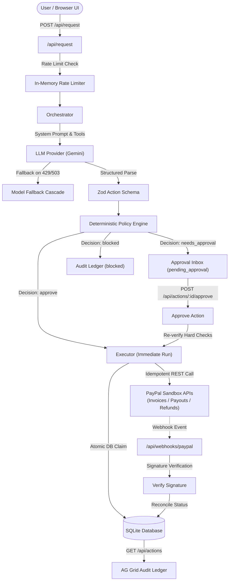

# Leash

> **An AI agent that runs your PayPal money tasks within rules you set.**

[](LICENSE)
[](https://github.com/itskavyansh/leash)
[](https://nextjs.org)

---

## Live Demo & Video Walkthrough

- **Live Demo**: [TODO]
- **Video Walkthrough**: [TODO]

---

## Why Leash?

Autonomous AI agents with tool-calling capabilities can write code, draft emails, and coordinate work—but giving an AI model direct API keys or unfettered access to bank accounts and payment gateways is a major financial risk. Prompts can be injected, models hallucinate parameters, and autonomous loops can quickly drain balances.

**The core thesis of Leash: The AI proposes, but deterministic code decides.**

Instead of letting an LLM execute payment APIs directly:
1. The AI translates unstructured natural language into a strictly typed, proposed financial action.
2. An uncompromising, deterministic **Policy Engine** evaluates the action against hard limits, auto-approval thresholds, daily caps, and recipient allowlists.
3. Only approved actions execute against PayPal Sandbox APIs. Risky or high-value actions halt in an interactive **Approval Inbox** awaiting human authorization.
4. Webhooks reconcile real-time payment settlement back into a persistent ledger.

---

## Features

- **Natural Language Intent Parsing**: Accepts plain-English requests (e.g., *"Pay Sam $120 for the illustration"* or *"Invoice Acme Corp $850 for the logo design"*), forcing structured tool calls via Google Gemini with strict Zod validation.
- **Dynamic Model Fallback Cascade**: If the primary Gemini model encounters transient outages or rate limits (HTTP 429/503), requests automatically cycle through any fallback models specified in your environment (`LLM_FALLBACK_MODELS`).
- **Deterministic Policy Engine**: Evaluates every action against financial rules before any payment gateway request is made.
- **Approval Inbox**: Pending actions requiring human review are staged as interactive cards where admins can inspect policy reasons, approve, or reject.
- **Atomic Execution & Idempotency**: Payment execution uses atomic database claims (`status = 'executing'`) and deterministic PayPal idempotency keys (`PayPal-Request-Id`) to guarantee against double-spending or race conditions.
- **Real-Time Settlement via Webhooks**: Ingests, cryptographically verifies, and reconciles PayPal sandbox webhooks (invoices paid, payouts completed/failed, captures refunded) into an immutable SQLite audit ledger.
- **AG Grid Audit Ledger**: Enterprise-grade table featuring multi-column sorting, built-in type filters, a quick-search filter, and a slide-over details drawer showing full request text, policy triggers, and PayPal IDs.
- **Configurable Policy Panel**: Adjust auto-approve limits, hard limits, daily caps, allowed recipient allowlists, and blocked action types with instant validation.
- **One-Click Demo Reset**: Reset actions, processed webhook deduplication logs, and policy rules back to seed state when demo mode is active.

---

## Architecture



---

## How the Policy Engine Works

The policy engine operates as a pure, deterministic function (`evaluate(action, rules, spentToday)`). It executes in a strict evaluation order where **Hard Rules** block immediately, **Soft Limits** route to human approval, and only requests passing all thresholds are auto-approved:

| Order | Rule Check | Condition | Decision | Rule Triggered |
| :---: | :--- | :--- | :---: | :--- |
| **1** | **Amount Validation** | Amount is non-positive or non-finite | **`blocked`** | `invalid_amount` |
| **2** | **Action Type Block** | Action type is in `blockedActionTypes` | **`blocked`** | `blocked_action_type` |
| **3** | **Recipient Allowlist** | `send_payout` recipient not in `allowedRecipients` | **`blocked`** | `recipient_not_allowed` |
| **4** | **Hard Limit** | Amount > `hardLimit` | **`blocked`** | `hard_limit` |
| **5** | **Daily Spending Cap** | `spentToday + amount > dailyCap` (skipped for invoices) | **`needs_approval`** | `daily_cap` |
| **6** | **Auto-Approve Threshold** | Amount > `autoApproveLimit` | **`needs_approval`** | `auto_limit` |
| **7** | **Within Limits** | Passes all above rules | **`approve`** | `within_limits` |

> **Important**: When a human approves an action from the Approval Inbox, the system **re-evaluates all Hard Rules (1–4)** against current rules before executing, preventing execution if an admin blocked that recipient or lowered the hard limit while the action was waiting.

---

## Tech & Tools Used

- **[Next.js 16 (App Router)](https://nextjs.org/)**: Full-stack framework with React 19, Turbopack, and server-side Route Handlers.
- **[TypeScript](https://www.typescriptlang.org/)**: Strict end-to-end type safety without any `any` types.
- **[SQLite (`better-sqlite3`)](https://github.com/WiseLibs/better-sqlite3)**: Fast local database with WAL mode storing actions, policy rules, and webhook deduplication records.
- **[Google Gemini (`@google/genai`)](https://github.com/google-gemini/gemini-api-js)**: Native structured tool-calling for intent extraction.
- **[Zod](https://zod.dev/)**: Runtime schema validation for tool calls, API request bodies, and rule mutations.
- **[PayPal Sandbox APIs](https://developer.paypal.com/)**: REST integrations for Invoicing v2, Payouts v1, Captures/Refunds v2, and Webhooks v1.
- **[AG Grid Community (v36)](https://www.ag-grid.com/)**: Fast financial grid with sorting, type filtering, quick-search, and custom cell renderers.
- **[Tailwind CSS v4](https://tailwindcss.com/)**: Modern dark-mode interface with accessible states and responsive design.
- **[Vitest](https://vitest.dev/)**: Test runner executing 90+ unit tests across policies, database, webhooks, orchestrator, and route handlers.
- **[Render](https://render.com/)**: Automated deployment configuration via Infrastructure-as-Code Blueprint (`render.yaml`).

---

## Setup & Run Locally

### Prerequisites

- **Node.js**: `>= 20.18.0`
- **npm**: `>= 10.0.0`
- **PayPal Developer Account**: Sandbox **Business (Merchant)** account based in the United States with **Invoicing**, **Payouts**, and **Transaction Search** capabilities enabled in the developer dashboard.

### Installation

1. **Clone the repository**:
   ```bash
   git clone https://github.com/itskavyansh/leash.git
   cd leash
   ```

2. **Install dependencies**:
   ```bash
   npm install
   ```

3. **Configure Environment Variables**:
   Copy the example environment template:
   ```bash
   cp .env.example .env.local
   ```
   Fill in the required credentials in `.env.local`:
   ```ini
   # PayPal Sandbox Credentials
   PAYPAL_ENV=sandbox
   PAYPAL_CLIENT_ID=your_sandbox_client_id
   PAYPAL_CLIENT_SECRET=your_sandbox_client_secret
   PAYPAL_WEBHOOK_ID=your_webhook_id_here
   WEBHOOK_SKIP_VERIFY=true

   # AI Provider Configuration (Google Gemini)
   LLM_PROVIDER=gemini
   LLM_MODEL=gemini-2.5-flash
   LLM_FALLBACK_MODELS=model-name-2,model-name-3
   GEMINI_API_KEY=your_gemini_api_key

   # Enable Demo Mode controls (Reset button)
   DEMO_MODE=true
   ```

4. **Run the Development Server**:
   ```bash
   npm run dev
   ```
   Open [http://localhost:3000](http://localhost:3000) in your browser.

5. **Run the Test Suite**:
   ```bash
   npm test
   ```

---

## "Try It" Walkthrough

Use the input box or the built-in example chips to test the autonomous policy engine:

1. **Auto-Approved Payout ($120)**:
   - **Input**: `"Pay Sam (sb-sub@example.com) $120 for the illustration"`
   - **Expected Outcome**: The payout is within the auto-approve limit ($200) and sent to an allowed recipient (`sb-sub@example.com`). It immediately executes via PayPal Payouts API and appears as **`approved` / `completed`** (green badge).
2. **Action Requiring Approval ($450)**:
   - **Input**: `"Pay Sam (sb-sub@example.com) $450 for the full brand package"`
   - **Expected Outcome**: Exceeds the $200 auto-approve limit. Staged in the **Approval Inbox** as **`pending_approval`** (amber badge). Clicking **Approve & Execute** completes the payment; clicking **Reject** marks it rejected.
3. **Auto-Approved Invoice ($850)**:
   - **Input**: `"Invoice Acme Corp (billing@acme.com) $850 for the logo design"`
   - **Expected Outcome**: Invoices request payment from clients rather than spending funds, so they do not count against your daily spending cap. The draft invoice is created and sent via PayPal Invoicing API.
4. **Policy Blocked Recipient**:
   - **Input**: `"Pay hacker@evil.com $50"`
   - **Expected Outcome**: Blocked immediately with reason: `Recipient "hacker@evil.com" is not in the allowed recipients list for payouts` (red badge). No payment call is made.

---

## PayPal Webhooks & Reconciliation

Leash provides a webhook handler endpoint at `/api/webhooks/paypal` to capture asynchronous payment lifecycle events:
- `INVOICING.INVOICE.PAID` & `CANCELLED`
- `PAYMENT.PAYOUTS-ITEM.SUCCEEDED` & `FAILED`
- `PAYMENT.PAYOUTSBATCH.SUCCESS`
- `PAYMENT.CAPTURE.REFUNDED`

### Setting up Sandbox Webhooks
1. In your PayPal Developer Dashboard, navigate to your REST App.
2. Add a Webhook URL pointing to your deployment: `https://<your-domain>/api/webhooks/paypal`.
3. Select the invoicing, payout, and payment capture events.
4. Copy the generated **Webhook ID** into your `PAYPAL_WEBHOOK_ID` environment variable.

### Simulating Webhooks Locally
To test the webhook processing pipeline without exposing a public tunnel:
```bash
npm run sim:webhook
```
This triggers synthetic PayPal webhook payloads against your local database to verify state transitions and deduplication.

---

## Security & Reliability Design

- **Code-Enforced Policies**: Rules are never left to prompt engineering or LLM discretion. Every financial decision is calculated deterministically in TypeScript.
- **Strict Injection Defense**: System prompts mandate that user input is treated strictly as plain data. Any prompt injection attempting to bypass limits or approve transfers is ignored.
- **PayPal Idempotency Keys**: All outbound calls generate unique `PayPal-Request-Id` headers derived from internal UUIDs, guaranteeing safe retries without duplicate payments.
- **Atomic Concurrency Protection**: Actions transition to `executing` status via atomic SQLite `UPDATE ... WHERE status = 'approved'` statements, preventing concurrent workers from running the same action twice.
- **Production Webhook Verification**: `WEBHOOK_SKIP_VERIFY` is automatically ignored in `NODE_ENV === "production"`, enforcing cryptographic validation of PayPal transmission signatures (`paypal-transmission-sig`, cert URL, and timestamp).
- **Anti-Spam Rate Limiting**: Write endpoints (`POST /api/request`, approve, and reject) are protected by a sliding-window rate limiter (20 requests per minute per IP), returning HTTP 429 when exceeded.

---

## License

This project is licensed under the [MIT License](LICENSE).
