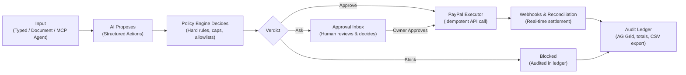

# Leash

> **A corporate card with rules, for your AI agent**

Giving an AI agent direct access to your company bank account or payment gateway is dangerous because models can hallucinate, loop, or follow malicious prompt injections. Leash solves this by placing an uncompromising, deterministic policy engine between your AI agent and the real payment rails. The AI proposes financial actions, but deterministic code decides what executes, what asks for your approval, and what gets blocked.

[](LICENSE)
[](https://nextjs.org)

---

## Live Demo & Video Walkthrough

- **Live Demo**: [TODO]
- **Video Walkthrough**: [TODO]

---

## Pipeline



---

## Features

- **Typed Requests**: Natural language requests translated into structured, typed actions via Google Gemini with strict Zod validation.
- **Documents (Untrusted Input)**: Ingests pasted text or uploaded PDF, PNG, and JPG invoices and receipts. Evaluates payments while treating the document strictly as untrusted data.
- **Agents over MCP**: Exposes a Model Context Protocol server over Streamable HTTP (`/api/mcp`) so external agents can check rules, run dry runs, and submit payment requests.
- **Ask Your Ledger**: Natural language question bar converts questions like "blocked payouts over $500 this week" into validated structured filters applied live to AG Grid.
- **Approval Brief**: AI-worded single-sentence summary for pending inbox items, computed exclusively from verified historical facts with zero free-text injection risk.
- **Deterministic Policy Rules**: Instant evaluation across auto-approve limits, hard limits, daily spend caps, allowed recipient allowlists, and blocked action types.
- **Audit Ledger with Totals & CSV**: AG Grid table with multi-column sorting, quick search, local timezone date filters, filtered totals pinned to the bottom row, and CSV export.

---

## Where AI Is Used

| Feature | What the AI Does | What Code Decides |
| :--- | :--- | :--- |
| **Parse Typed Request** | Extracts recipient, amount, action type, and description into a structured tool call. | Zod validates the schema. The deterministic policy engine evaluates limits, caps, and allowlists. |
| **Extract Payments from Documents** | Reads untrusted text or images (PDF/PNG/JPG) and proposes payable items. | Enforces a maximum of 10 proposals. Evaluates each proposal sequentially against policy rules and accumulated daily spend. |
| **MCP Agent Demo** | Autonomous agent formulates procurement goals and calls MCP tools. | MCP tools only allow checking rules and requesting payments. Agents cannot approve, edit rules, or bypass policy. |
| **Ledger Query to Filters** | Translates natural language questions into structured filter criteria (`apply_filters`). | Zod validates filter ranges and enums. Safe client code translates criteria into AG Grid filter models. |
| **Approval Brief Wording** | Words a concise summary sentence using only pre-computed numeric facts. | Computes all facts in pure code. Validates that every number in the brief is authentic, with zero URLs, emails, or free text allowed. |

---

## What the AI Cannot Do

- **The AI cannot approve payments**: Every payment proposal must pass through the deterministic policy engine. If an action exceeds limits, only a human can authorize it.
- **The AI cannot modify policy rules**: Rules, spending caps, and allowlists are stored in the database and can only be updated by direct user configuration.
- **The AI cannot bypass the policy engine**: Even if a user, document, or agent requests an override, the policy code executes unconditionally.
- **Documents and memos are untrusted**: The AI can be fooled by adversarial prompts, prompt injections, or manipulated text inside invoices. The system assumes the AI can be fooled. The deterministic policy engine still holds and rejects unauthorized recipients or amounts exceeding hard limits regardless of what the AI proposes.

---

## Tools Used

- **PayPal APIs**: Integrates with PayPal REST endpoints including OAuth2 token creation (`/v1/oauth2/token`), Invoicing v2 draft creation and sending (`/v2/invoicing/invoices`, `/send`), Payouts v1 batch creation (`/v1/payments/payouts`), Captures v2 refunds (`/v2/payments/captures/{id}/refund`), status reconciliation (`/v1/payments/payouts/{id}`, `/v2/invoicing/invoices/{id}`, `/v2/payments/refunds/{id}`), and Webhook signature verification (`/v1/notifications/verify-webhook-signature`).
- **Google Gemini**: Uses `@google/genai` with `gemini-2.5-flash` (and configured fallbacks) for structured tool calling, document payment extraction via inline image data, natural language ledger queries, and approval brief wording.
- **AG Grid Community (v36)**: Implements client-side sorting, column filtering (`agTextColumnFilter`, `agNumberColumnFilter`, `agDateColumnFilter` with local timezone comparator), quick filter, pinned bottom totals row, and CSV export (`exportDataAsCsv`).
- **Render**: Deploys web service instances with automated builds from GitHub and health checks via `/api/health`.
- **Supabase Postgres**: Persistent relational database with SSL connection pooling, storing rules, actions, and processed webhook deduplication events.
- **MCP TypeScript SDK**: Uses `@modelcontextprotocol/sdk` (v1.32.2) over Streamable HTTP in stateless mode to provide tool capabilities to external agents.

---

## Setup and Local Development

### Prerequisites

- Node.js >= 20.18.0
- npm >= 10.0.0
- PayPal Developer Sandbox account

### Installation

1. Clone the repository and install dependencies:
   ```bash
   git clone https://github.com/itskavyansh/leash.git
   cd leash
   npm install
   ```

2. Configure environment variables:
   Copy `.env.example` to `.env.local` and provide your credentials:
   ```bash
   cp .env.example .env.local
   ```

   **Required Environment Variable Names:**
   - `DATABASE_URL` (Postgres / Supabase connection URL)
   - `PAYPAL_ENV` (`sandbox` or `production`)
   - `PAYPAL_CLIENT_ID` (PayPal REST application client ID)
   - `PAYPAL_CLIENT_SECRET` (PayPal REST application secret)
   - `PAYPAL_WEBHOOK_ID` (PayPal webhook ID for signature verification)
   - `WEBHOOK_SKIP_VERIFY` (`true` to skip verification in non-production local development)
   - `LLM_PROVIDER` (`gemini`)
   - `LLM_MODEL` (`gemini-2.5-flash`)
   - `LLM_FALLBACK_MODELS` (Comma-separated fallback model names)
   - `GEMINI_API_KEY` (Google Gemini API key)
   - `DEMO_MODE` (`true` to enable demo reset controls)
   - `LEASH_MCP_TOKEN` (Bearer token for MCP endpoint authentication)
   - `DEFAULT_ALLOWED_RECIPIENTS` (Optional comma-separated email list appended to default seed rules)
   - `DEMO_AGENT_RECIPIENT` (Optional recipient email for the demo agent script)

3. Run the development server:
   ```bash
   npm run dev
   ```
   Open [http://localhost:3000](http://localhost:3000) in your browser.

4. Run tests:
   ```bash
   npm test
   ```
   All tests run against in-memory `@electric-sql/pglite` without requiring external network connections.

---

## Deployment Notes

- Deployable as a web service on Render, Vercel, or any Node.js container host.
- A ready-to-use Blueprint is included in `render.yaml`.
- When deployed on Render free instances, the service may spin down after periods of inactivity and take a moment to wake on the initial request.

---

## License

This project is licensed under the [MIT License](LICENSE).
